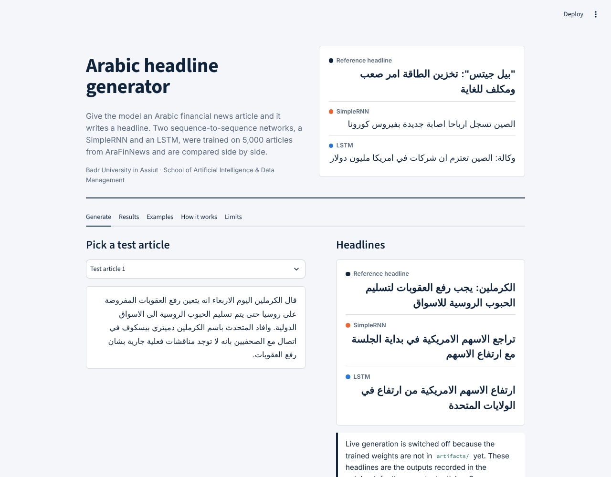
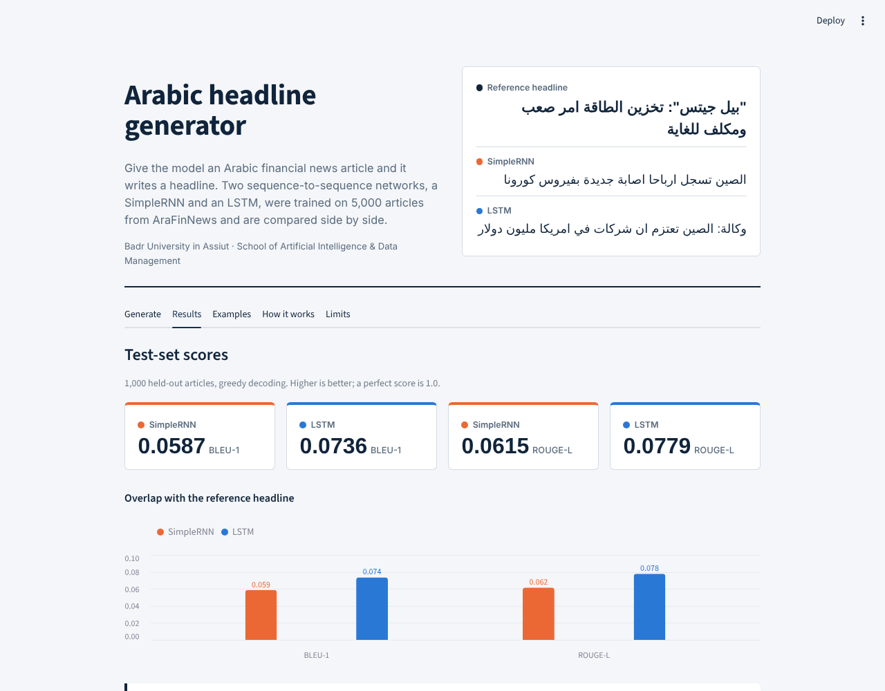

# Arabic News Headline Generation

Generate a headline for an Arabic financial news article with two sequence-to-sequence networks, a **SimpleRNN** and an **LSTM** encoder-decoder, trained on the [AraFinNews](https://huggingface.co/datasets/drelhaj/AraFinNews) dataset and served in an interactive **Streamlit** app.

> Course project · Badr University in Assiut · School of Artificial Intelligence & Data Management



## Results

Test set of 1,000 unseen articles, greedy decoding (from `notebooks/NLP2.ipynb`):

| Model | BLEU-1 | ROUGE-L | Best val. loss | Val. token accuracy (epoch 20) | Parameters |
|---|---|---|---|---|---|
| SimpleRNN | 0.0587 | 0.0615 | 6.98 (epoch 10) | 16.4% | ~35.5 M |
| LSTM | **0.0736** | **0.0779** | 7.17 (epoch 19) | 13.1% | ~35.7 M |

The LSTM overlaps more with the reference headlines (about +25% BLEU-1, +27% ROUGE-L), but **both models are weak**. Their headlines read like Arabic news but usually do not describe the article: on the ten recorded test articles every LSTM headline opens with either "ارتفاع" or "وكالة: الصين تعتزم". The cause is a small sample (5,000 pairs) against a 92,121-word vocabulary, no attention, and greedy decoding. The full analysis is in [`docs/Project_Report.pdf`](docs/Project_Report.pdf) and the [Challenges section](#challenges-and-limits) below.



## What is in the app

| Tab | Content |
|---|---|
| **Generate** | Paste an Arabic article (or pick a test article) and compare both models' headlines with the reference. |
| **Results** | BLEU-1 / ROUGE-L, training and validation curves, per-epoch table. |
| **Examples** | The first ten test articles with reference, SimpleRNN and LSTM headlines. |
| **How it works** | Pipeline, architecture, training settings, metric definitions. |
| **Limits** | What the models get wrong and what to try next. |

Live generation needs the trained weights in `artifacts/` (see [Enable live generation](#enable-live-generation)). Without them the app still runs and shows the headlines recorded in the notebook.

## Repository structure

```
├── app.py                      Streamlit app
├── src/
│   ├── preprocessing.py        Arabic cleaning + tokenisation (copied from the notebook)
│   ├── inference.py            Pure-NumPy SimpleRNN/LSTM encoder-decoder, greedy decoding
│   └── ui.py                   Theme and HTML helpers
├── data/                       Results recorded from the notebook (metrics, curves, 10 examples)
├── artifacts/                  Trained weights + vocabulary (add after running the notebook)
├── notebooks/NLP2.ipynb        The original, unmodified training notebook
├── scripts/                    Export of trained models for the app
├── tests/                      Checks that the NumPy code matches Keras exactly
├── docs/                       Report (PDF/DOCX), notebook guide, deployment guide
└── .streamlit/config.toml      Theme
```

## Run locally

```bash
git clone https://github.com/salama1229/arabic-headline-generation.git
cd arabic-headline-generation
python -m venv .venv && source .venv/bin/activate      # Windows: .venv\Scripts\activate
pip install -r requirements.txt
streamlit run app.py
```

## Enable live generation

The notebook does not save its models, so export them once from the Colab session that trained them. The notebook itself stays unchanged.

1. Run `notebooks/NLP2.ipynb` to the end.
2. In a **new cell** run the code in [`scripts/colab_export_snippet.py`](scripts/colab_export_snippet.py). It writes `artifacts/vocab.json`, `rnn_weights.npz` and `lstm_weights.npz` (float16, about 70 MB each, under GitHub's 100 MB limit).
3. Download the `artifacts/` folder, copy it into this repository, then commit and push.

Details are in [`docs/DEPLOYMENT.md`](docs/DEPLOYMENT.md).

## Deploy on Streamlit Community Cloud

1. Push this repository to GitHub (public).
2. Go to [share.streamlit.io](https://share.streamlit.io), choose **Create app**, select the repository, branch `main`, main file `app.py`.
3. Under **Advanced settings** pick Python 3.11 or newer, then **Deploy**.

The app needs only `streamlit`, `numpy`, `pandas` and `altair`. TensorFlow is **not** required for serving, because inference is implemented in NumPy and verified against Keras in `tests/`.

## Method in brief

- **Data:** AraFinNews parquet files from Hugging Face. Half of the rows in every split are empty and were dropped; a reproducible subset (seed 42) of **5,000 / 1,000 / 1,000** train / validation / test pairs was used.
- **Cleaning:** HTML entities, URLs and tags removed; diacritics and tatweel removed; alef forms unified.
- **Tokens:** whitespace words, vocabulary of 92,121 entries (`[PAD] [UNK] [SOS] [EOS]` + all training words); articles cut to 80 tokens, headlines to 20.
- **Models:** embedding (128) → SimpleRNN or LSTM (128 units) encoder; decoder initialised with the encoder state; softmax over the vocabulary. Teacher forcing.
- **Training:** Adam (lr 5e-4, clipnorm 1.0), batch 32, 20 epochs, dropout 0.1, padding masked with sample weights.
- **Evaluation:** BLEU-1 and a word-level ROUGE-L (LCS F-score) on the cleaned headline.

## Challenges and limits

- Half of each split is empty; ~70 s per epoch limited the sample to 5,000 training pairs.
- 92,121 distinct tokens for 5,000 articles: most words are seen once, so embeddings are poorly trained.
- Punctuation stays attached to words and only some Arabic spelling variants are normalised, which splits the vocabulary further.
- Only the first 80 of ~180 article words are encoded, and there is no attention.
- Greedy decoding produces generic openings and repeated words. The app has an optional "Block repeated words" switch (not part of the notebook).
- One run per model, no significance test: the SimpleRNN/LSTM gap is indicative only.

**Next steps:** train on the full ~170,000 pairs with subword tokens, add attention or fine-tune an Arabic pretrained model (AraT5, AraBART, mT5), use beam search, report ROUGE-1/2/L and BERTScore with a first-sentence baseline.

## Documentation

- [`docs/Project_Report.pdf`](docs/Project_Report.pdf) / [`.docx`](docs/Project_Report.docx): full project report in the university template.
- [`docs/NOTEBOOK_GUIDE.md`](docs/NOTEBOOK_GUIDE.md): cell-by-cell guide to the notebook, with outputs.
- [`docs/DEPLOYMENT.md`](docs/DEPLOYMENT.md): exporting the models and deploying the app.

## Team

| Name |
|---|
| Ali Omar |
| Zizi Mostafa |
| Shaza Abdulnasser |

Badr University in Assiut, School of Artificial Intelligence & Data Management.

## Acknowledgements

Dataset: AraFinNews (`drelhaj/AraFinNews`, Hugging Face).

## License

MIT, see [LICENSE](LICENSE). The dataset has its own terms.
